# HealthRisk AI — hastalığa özgü mevcut durum sınıflandırması (araştırma prototipi)

> **English summary.** Research prototype of disease-specific machine-learning models that classify a person's
> **current** clinical status (e.g. undiagnosed diabetes, liver stiffness ≥ 8 kPa, atrial fibrillation on a 12-lead ECG).
> It does **not** predict future risk. Frozen models and frozen thresholds are served by a localhost-only FastAPI backend
> and a React frontend that routes each input to the models it can support and shows evidence tiers and limitations
> instead of probabilities. Not a clinical decision tool. UI and documentation are in Turkish.

> ⚠️ **Araştırma prototipidir; mevcut durum sınıflandırması yapar, gelecek risk tahmini değildir; negatif sonuç
> hastalığı dışlamaz; tanı ve tedavi için hekime başvurun.** Klinik onaylı değildir. Model olasılıkları klinik
> olasılık değildir ve arayüzde gösterilmez.

<p align="center">
  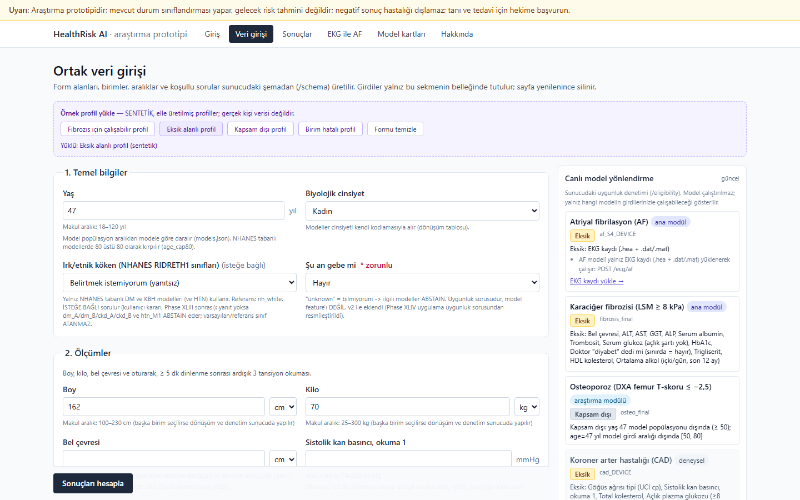
  <br><sub>Veri girişi (şemadan dinamik üretilen form) ve canlı model yönlendirme paneli — sentetik profil</sub>
</p>

## İçindekiler

- [Proje ne yapar?](#proje-ne-yapar)
- [Arayüz](#arayüz)
- [Modeller ve doğrulanmış metrikler](#modeller-ve-doğrulanmış-metrikler)
- [Mimari](#mimari)
- [Yöntem ve tekrarlanabilirlik](#yöntem-ve-tekrarlanabilirlik)
- [Kurulum ve çalıştırma](#kurulum-ve-çalıştırma)
- [Testler](#testler)
- [Depo içeriği](#depo-içeriği)
- [Veri kaynakları ve lisanslar](#veri-kaynakları-ve-lisanslar)
- [Sınırlılıklar](#sınırlılıklar)

## Proje ne yapar?

Her model tek bir hastalık için kişinin **o anki** durumunu sınıflandırır: hedef, aynı ziyaretteki ölçüm veya tanıdır
(ör. HbA1c ≥ %6,5, FibroScan LSM ≥ 8 kPa, DXA T-skoru ≤ −2,5, EKG ritmi). Gelecekte hastalık gelişme riski tahmin
edilmez.

Uygulama **kanıta duyarlı yönlendirme** yapar:

- **Canlı panel:** girdiler değiştikçe her model için sunucuya sorar ve modelin durumunu gösterir: *Çalışabilir*,
  *Eksik: …* (hangi alanların gerektiği), *Kapsam dışı: …* (ör. yaş aralığı, gebelik) veya *Karar verilemez*.
- **Sonuç:** donmuş eşiğe göre yalnız "ileri değerlendirme önerilir" ya da "eşik altında" gösterilir. Olasılık gösterilmez.
- **Kanıt katmanları ayrı tutulur:** iç test, zamansal doğrulama ve bağımsız dış doğrulama ayrı rozet ve tablolarda
  gösterilir; çapraz doğrulama sonuçları kanıt olarak sunulmaz.
- **Eksik veri doldurulmaz:** zorunlu alan eksikse model karar üretmez (ABSTAIN).
- **Hedefi tanımlayan girdi uyarısı:** hastalığı tanımlayan değer (ör. HbA1c, ölçülen yüksek tansiyon) girildiyse,
  model yerine doğrudan klinik eşiğin kullanılması gerektiği belirtilir.
- **Modül etiketi:** AF ve karaciğer fibrozisi *ana modül*, osteoporoz *araştırma modülü*, diğerleri *deneysel*.

## Arayüz

Ekran görüntüleri sentetik profillerle ve açık PTB-XL örnek kayıtlarıyla alınmıştır (gerçek kişi verisi değildir).

| Giriş | Sonuç ekranı |
|---|---|
| 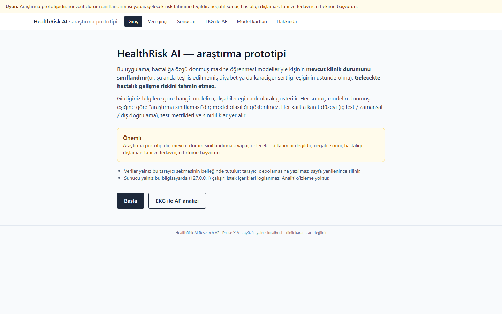 | 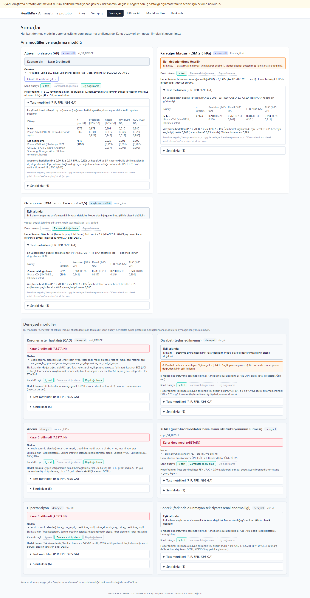 |
| Amaç, uyarı, "Başla" ve "EKG ile AF analizi" | Model kartları: karar, ABSTAIN nedeni, kanıt düzeyi, P/R/FPR/AUC ve %95 GA, sınırlılıklar; deneyseller ayrı ve gri |

| EKG ile AF analizi | Model kartları |
|---|---|
| 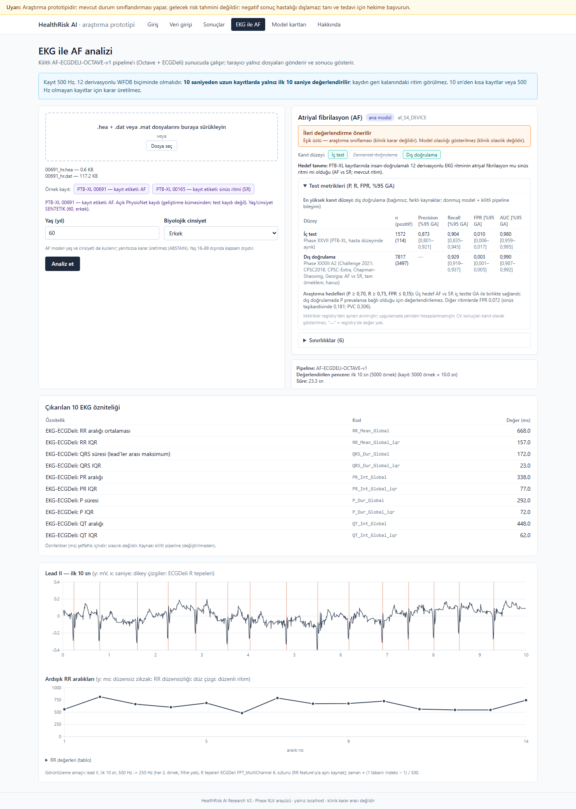 | 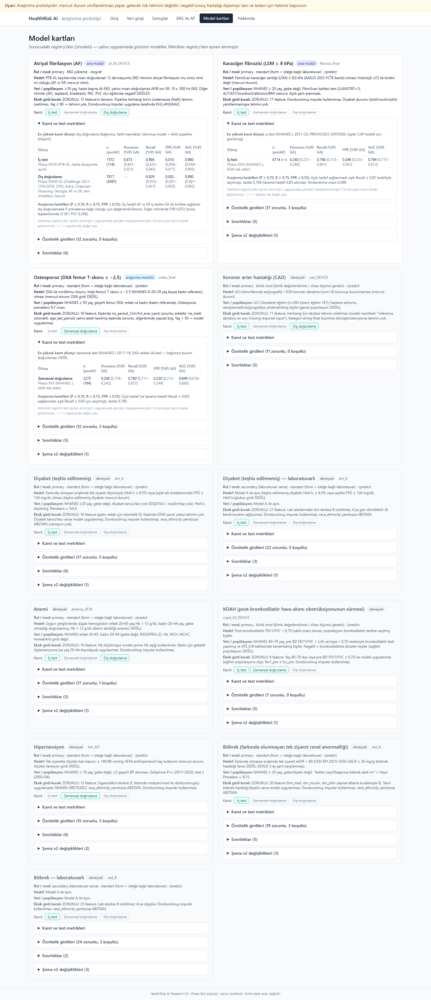 |
| `.hea` + `.dat`/`.mat` yükleme → kilitli Octave/ECGDeli pipeline'ı → 10 öznitelik, lead II grafiği ve R tepeleri, RR takogramı | Her model için hedef, popülasyon, girdiler, kanıt ve sınırlılıklar |

<details>
<summary>Diğer ekranlar (birim hatası, kapsam dışı, sinüs ritmi örneği, hakkında)</summary>

| | |
|---|---|
| 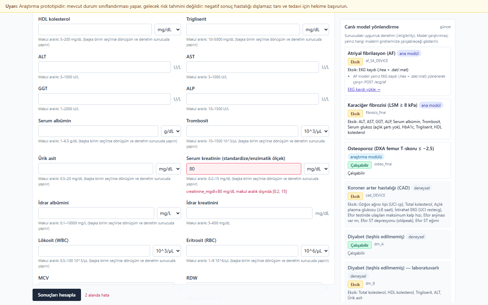 | 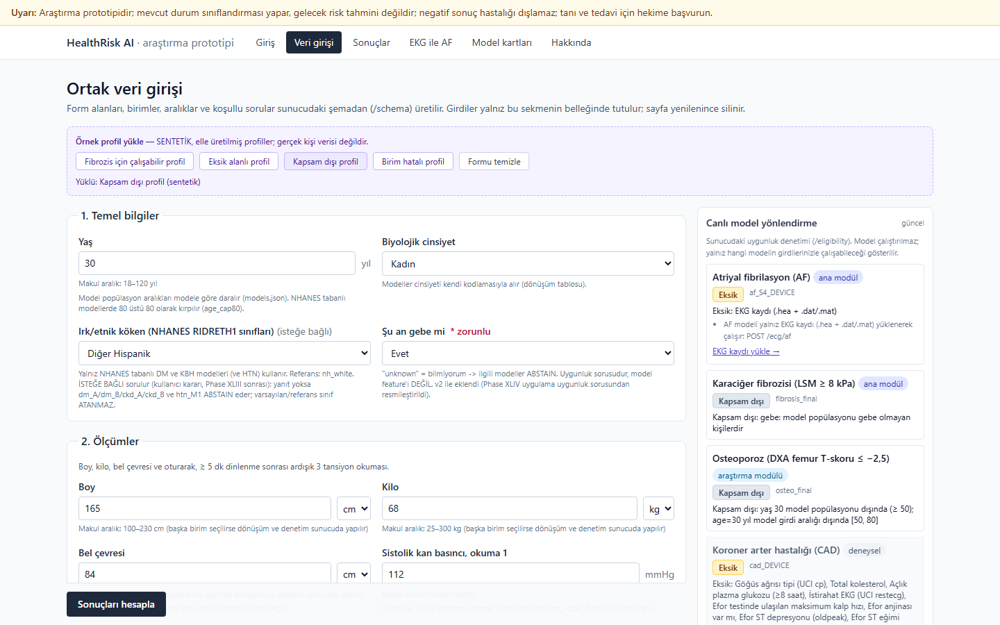 |
| Yanlış birimde girilen değer: sunucunun aralık hatası alanın altında | Gebe profil: gebelik dışlaması olan modeller kapsam dışı |
| 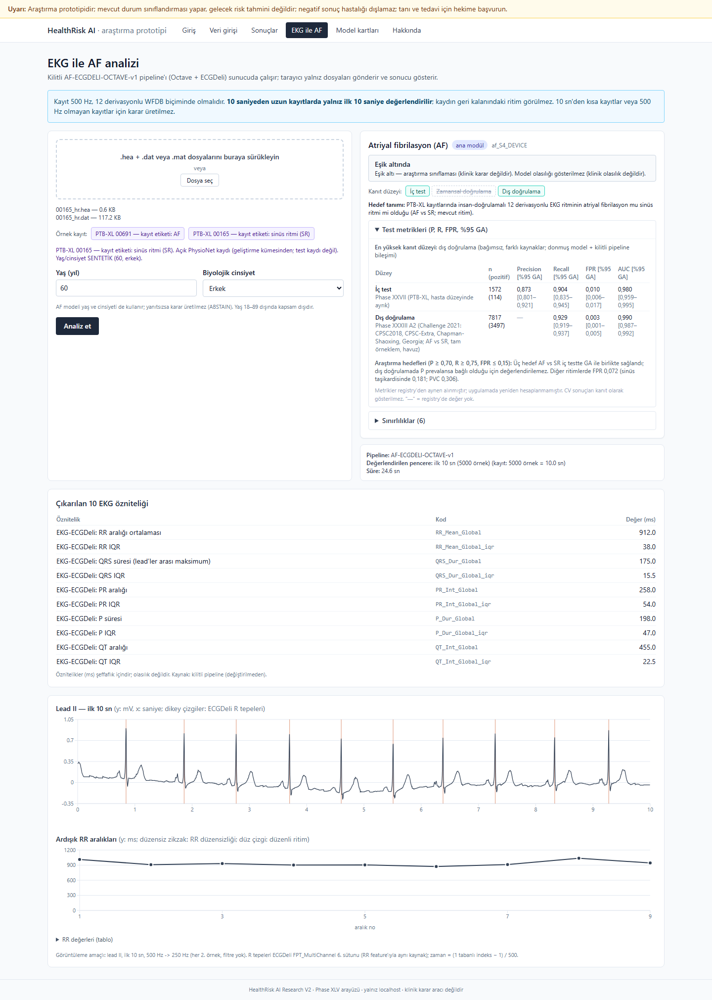 | 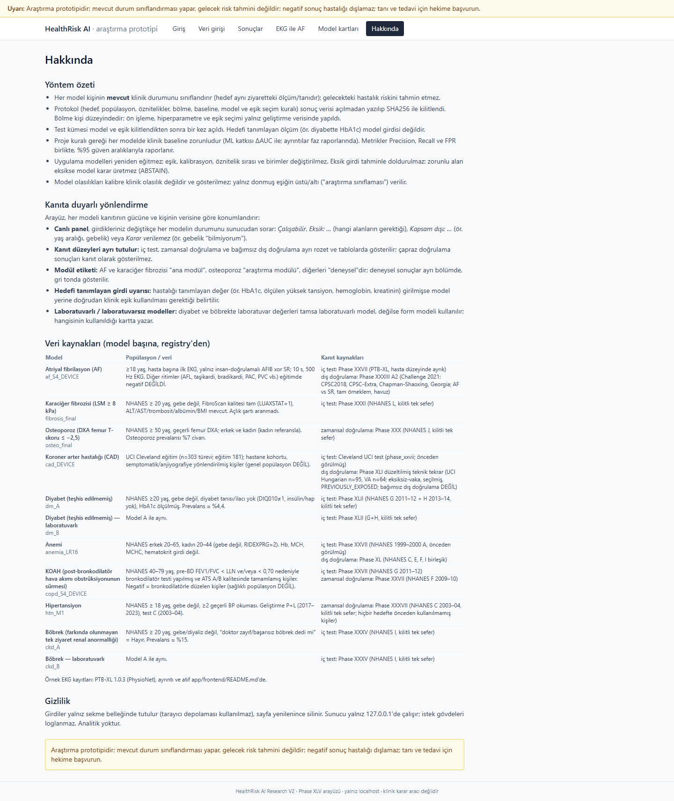 |
| Sinüs ritmi örneği: düzenli RR takogramı | Yöntem özeti ve model başına veri kaynakları |

</details>

## Modeller ve doğrulanmış metrikler

Uygulamada 11 model görünür (`app_visible`). Registry'deki 2 model daha (MI ve kalp yetmezliği) uygulamada
yoktur. MI için öznitelik üretim pipeline'ı yoktur ve yalnız iç test vardır. Kalp yetmezliği modeli özel bir RIP3 testine dayanır, n = 37'dir ve dış doğrulaması yoktur.

<p align="center">
  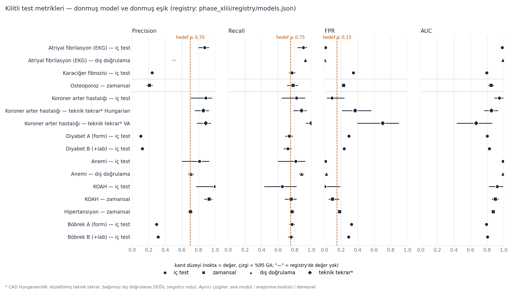
</p>

Aşağıdaki tablo ve grafik `phase_xliii/registry/models.json` dosyasından betikle üretilmiştir
(`phase_xlv/scripts/build_readme_assets.py`). Metrikler yeniden hesaplanmamıştır; donmuş model ve donmuş eşikteki kilitli,
tek seferlik test sonuçlarıdır. Oranlar için Wilson, AUC için bootstrap %95 GA kullanılmıştır. "—" registry'de değer
olmadığını gösterir. AF dış doğrulamasında Precision prevalansa bağlı olduğu için değerlendirilemez.

**Üç araştırma hedefi** P ≥ 0,70, R ≥ 0,75, FPR ≤ 0,15'tir ve aynı model ile aynı eşikte birlikte sağlanmalıdır. Son
sütun yalnız nokta tahminine bakar; güven aralığını hesaba katmaz. Bu hedefler araştırma hedefidir, **klinik onay
kriteri değildir**.

| model | modül | kanıt düzeyi | kaynak | n (pozitif) | Precision | Recall | FPR | AUC | üç hedef (nokta) |
|---|---|---|---|---|---|---|---|---|---|
| Atriyal fibrilasyon (EKG) (`af_S4_DEVICE`) | ana modül | iç test | Phase XXVII (PTB-XL, hasta düzeyinde ayrık) | 1572 (114) | 0,873 [0,801–0,921] | 0,904 [0,835–0,945] | 0,010 [0,006–0,017] | 0,980 [0,959–0,995] | evet |
| Atriyal fibrilasyon (EKG) (`af_S4_DEVICE`) | ana modül | dış doğrulama | Phase XXXIII A2 (Challenge 2021: CPSC2018, CPSC-Extra, Chapman-Shaoxing, Georgia; AF vs SR, tam örneklem, havuz) | 7817 (3497) | — | 0,929 [0,919–0,937] | 0,003 [0,001–0,005] | 0,990 [0,987–0,992] | değerlendirilemez |
| Karaciğer fibrozisi (`fibrosis_final`) | ana modül | iç test | Phase XXXI (NHANES L, kilitli tek sefer) | 4714 (—) | 0,240 [0,221–0,260] | 0,768 [0,733–0,801] | 0,346 [0,332–0,361] | 0,794 [0,773–0,813] | hayır |
| Osteoporoz (`osteo_final`) | araştırma modülü | zamansal | Phase XXX (NHANES J, kilitli tek sefer) | 2275 (164) | 0,208 [0,178–0,242] | 0,780 [0,711–0,837] | 0,230 [0,213–0,249] | 0,849 [0,818–0,880] | hayır |
| Koroner arter hastalığı (`cad_DEVICE`) | deneysel | iç test | Cleveland UCI test (phase_xxvii; önceden görülmüş) | 61 (28) | 0,885 [0,710–0,960] | 0,821 [0,644–0,921] | 0,091 [0,031–0,236] | 0,948 [0,888–0,990] | evet |
| Koroner arter hastalığı (`cad_DEVICE`) | deneysel | teknik tekrar* Hungarian | Phase XLI düzeltilmiş teknik tekrar (UCI Hungarian n=95, VA n=64; eksiksiz-vaka, seçilmiş, PREVIOUSLY_EXPOSED; bağımsız dış doğrulama DEĞİL) | 95 (68) | 0,857 [0,757–0,921] | 0,882 [0,785–0,939] | 0,370 [0,215–0,558] | 0,852 [0,766–0,928] | hayır |
| Koroner arter hastalığı (`cad_DEVICE`) | deneysel | teknik tekrar* VA | Phase XLI düzeltilmiş teknik tekrar (UCI Hungarian n=95, VA n=64; eksiksiz-vaka, seçilmiş, PREVIOUSLY_EXPOSED; bağımsız dış doğrulama DEĞİL) | 64 (54) | 0,885 [0,782–0,943] | 1,000 [0,934–1,000] | 0,700 [0,397–0,892] | 0,667 [0,437–0,859] | hayır |
| Diyabet A (form) (`dm_A`) | deneysel | iç test | Phase XLII (NHANES G 2011–12 + H 2013–14, kilitli tek sefer) | 8895 (389) | 0,103 [0,092–0,115] | 0,733 [0,687–0,774] | 0,292 [0,282–0,302] | 0,800 [0,781–0,819] | hayır |
| Diyabet B (+lab) (`dm_B`) | deneysel | iç test | Phase XLII (G+H, kilitli tek sefer) | 8895 (389) | 0,122 [0,109–0,136] | 0,715 [0,668–0,757] | 0,236 [0,227–0,245] | 0,826 [0,808–0,843] | hayır |
| Anemi (`anemia_LR16`) | deneysel | iç test | Phase XXVII (NHANES 1999–2000 A, önceden görülmüş) | 410 (21) | 0,810 [0,600–0,923] | 0,810 [0,600–0,923] | 0,010 [0,004–0,026] | 0,991 [0,980–0,999] | evet |
| Anemi (`anemia_LR16`) | deneysel | dış doğrulama | Phase XL (NHANES C, E, F, I birleşik) | 11171 (669) | 0,709 [0,678–0,739] | 0,883 [0,857–0,906] | 0,023 [0,020–0,026] | 0,991 [0,989–0,993] | evet |
| KOAH (`copd_S4_DEVICE`) | deneysel | iç test | Phase XXVII (NHANES G 2011–12) | 37 (20) | 1,000 [0,772–1,000] | 0,650 [0,433–0,819] | 0,000 [0,000–0,184] | 0,921 [0,824–0,988] | hayır |
| KOAH (`copd_S4_DEVICE`) | deneysel | zamansal | Phase XXVII (NHANES F 2009–10) | 250 (156) | 0,929 [0,871–0,962] | 0,756 [0,683–0,817] | 0,096 [0,051–0,172] | 0,898 [0,857–0,934] | evet |
| Hipertansiyon (`htn_M1`) | deneysel | zamansal | Phase XXXVII (NHANES C 2003–04, kilitli tek sefer; hiçbir hedefte önceden kullanılmamış kişiler) | 2798 (1001) | 0,702 [0,675–0,729] | 0,766 [0,739–0,791] | 0,181 [0,164–0,199] | 0,875 [0,862–0,887] | hayır |
| Böbrek A (form) (`ckd_A`) | deneysel | iç test | Phase XXXV (NHANES I, kilitli tek sefer) | 4812 (716) | 0,293 [0,273–0,314] | 0,767 [0,734–0,796] | 0,323 [0,309–0,337] | 0,791 [0,773–0,809] | hayır |
| Böbrek B (+lab) (`ckd_B`) | deneysel | iç test | Phase XXXV (NHANES I, kilitli tek sefer) | 4812 (716) | 0,313 [0,291–0,335] | 0,754 [0,721–0,784] | 0,290 [0,276–0,304] | 0,805 [0,788–0,823] | hayır |

\* CAD Hungarian/VA satırları düzeltilmiş teknik tekrardır. Bu kişiler daha önce görülmüştür ve bu satırlar bağımsız
dış doğrulama **değildir** (registry notu).

**Modeller ve aileleri** (registry): AF — LightGBM (12 öznitelik; 10 EKG aralık özniteliği + yaş, cinsiyet) · CAD —
lojistik regresyon + sigmoid kalibrasyon · Diyabet A/B — lojistik regresyon · Anemi — kalibre lojistik regresyon ·
KOAH — lojistik regresyon · Hipertansiyon — lojistik regresyon (RandomOverSampler) · Fibrozis — CatBoost · Osteoporoz —
lojistik regresyon · Böbrek A/B — LightGBM. Hedef tanımları, popülasyonlar ve model başına sınırlılıklar arayüzdeki
*Model kartları* ekranında ve registry'dedir.

## Mimari

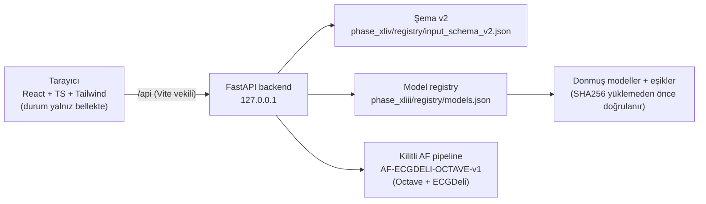

| uç nokta | görev |
|---|---|
| `GET /schema` | form tanımı: alanlar, birimler, aralıklar, koşullu sorular, bölümler, sabit uyarı metni |
| `GET /models` | uygulamada görünen modeller: hedef, popülasyon, kanıt katmanları, sınırlılıklar |
| `POST /eligibility` | canlı panel: model başına uygunluk ve eksik alanlar (**model çalıştırmaz**) |
| `POST /predict` | birim dönüşümü → doğrulama → uygunluk → dönüşümler → donmuş model → eşik üstü/altı |
| `POST /ecg/af` | WFDB `.hea` + `.dat`/`.mat` → ilk 10 sn → kilitli ECGDeli → 10 öznitelik → AF modeli |
| `GET /health` | registry, şema, model ve pipeline kilidi SHA256 durumu; paket sürümleri |

İlkeler:

- Model mantığı, birim dönüşümü ve uygunluk kararı backend'dedir. Frontend yalnız değeri ve seçilen birimi gönderir.
- Form şemadan dinamik üretilir. Sabit uyarı metninin tek kaynağı backend'dir.
- Sağlık verisi loglanmaz ve diske yazılmaz; tarayıcıda kalıcı saklanmaz (localStorage, sessionStorage ve IndexedDB
  kullanılmaz); analitik yoktur.

## Yöntem ve tekrarlanabilirlik

- **Kilitli protokol:** hedef, popülasyon, öznitelikler, bölme, baseline, model ve eşik seçim kuralı sonuç verisi
  açılmadan yazılır ve SHA256 ile kilitlenir.
- **Bölme ve seçim:** bölme kişi düzeyindedir, mümkünse zamansaldır. Ön işleme, hiperparametre ve eşik seçimi yalnız
  geliştirme verisinde yapılır.
- **Test:** test kümesi model ve eşik kilitlendikten sonra bir kez açılır.
- **Girdi kuralı:** hedefi tanımlayan ölçüm veya doğrudan türevi model girdisi olamaz. Her modelde klinik baseline
  zorunludur.
- **Uygulama:** modeller yeniden eğitilmez. Eşik, kalibrasyon, öznitelik sırası ve birimler değiştirilmez.
  Uygulamadaki öznitelik üretiminin geliştirme verisiyle birebirliği parity testleriyle denetlenir
  (`phase_xliv/03_tests.md`).
- **Faz bütünlüğü:** her faz kendi klasöründe çalışır. Önceki faz dosyaları salt okunurdur. Faz başında ve sonunda
  tüm ağacın SHA256 envanteri alınır.

Faz raporları: [Phase XLIII — registry](phase_xliii/PHASE_XLIII_REPORT.md) · [Phase XLIV — backend](phase_xliv/PHASE_XLIV_REPORT.md) ·
[Phase XLV — arayüz](phase_xlv/PHASE_XLV_REPORT.md).

## Kurulum ve çalıştırma

> **Önemli:** Bu depo yalnız registry (Phase XLIII), backend ve arayüz kodunu, Phase XLIV–XLV çıktılarını içerir.
> Uygulamanın çalışması için gereken şu dosyalar depoda **yoktur**:
> - registry'nin işaret ettiği **model dosyaları** (önceki faz klasörlerinde),
> - **Octave/ECGDeli çalışma ortamı**,
> - ham veriler ve önceki fazlar.
>
> Bu nedenle depo tek başına klonlanıp çalıştırılamaz. Sunucu, eksik veya SHA256'sı uyuşmayan modelleri devre dışı
> bırakır ve `/health`'te raporlar.

Tam araştırma ağacı mevcutsa (Windows, Python 3.13.3, Node.js 22):

```powershell
# Backend
cd app\backend
python -m venv .venv
.venv\Scripts\python.exe -m pip install -r requirements.lock
.venv\Scripts\python.exe -B run_server.py --port 8000        # http://127.0.0.1:8000

# Arayüz (ayrı terminal)
cd app\frontend
npm ci
npm run build
npm run preview                                              # http://127.0.0.1:4173
```

Ayrıntılar: [app/backend/README.md](app/backend/README.md), [app/frontend/README.md](app/frontend/README.md).

## Testler

| paket | sonuç (Phase XLV sonu) |
|---|---|
| Backend pytest (birim dönüşümleri, 46 dönüşüm, parity, gizlilik, AF uçtan uca, senaryolar) | 311 geçti, 5 strict-xfail (onaylı BMI dönem hassasiyeti sınırlılığı), 0 hata |
| Vitest + React Testing Library | 33/33 |
| Playwright uçtan uca (canlı backend): normal, eksik, birim hatası, kapsam dışı (AF ve fibrozis), gizlilik | 20/20 |

Raporlar: [phase_xliv/03_tests.md](phase_xliv/03_tests.md), [phase_xlv/02_tests.md](phase_xlv/02_tests.md).

## Depo içeriği

| klasör | içerik |
|---|---|
| `app/backend/` | FastAPI sunucusu, yapılandırma, pytest paketi |
| `app/frontend/` | React arayüzü, Vitest ve Playwright testleri, örnek EKG kayıtları |
| `phase_xliii/` | model registry (`registry/models.json`), v1 giriş şeması, denetim |
| `phase_xliv/` | backend fazı: şema v2, parity, ortam eşdeğerliği, testler |
| `phase_xlv/` | arayüz fazı: raporlar, ekran görüntüleri, AF süre analizi, test sonuçları |
| `docs/assets/` | README görselleri (registry'den üretilmiş) |

## Veri kaynakları ve lisanslar

Modellerin geliştirildiği ve doğrulandığı kaynaklar (registry'deki `source` alanlarından):

- **NHANES** (CDC/NCHS): diyabet, böbrek, hipertansiyon, karaciğer fibrozisi, osteoporoz, anemi, KOAH.
- **PTB-XL** (PhysioNet): AF modeli geliştirme ve iç test.
- **PhysioNet/Computing in Cardiology Challenge 2021** (CPSC2018, CPSC-Extra, Chapman-Shaoxing, Georgia): AF dış
  doğrulama.
- **UCI Heart Disease** (Cleveland; Hungarian ve VA teknik tekrar): CAD.

Depodaki iki örnek EKG kaydı (`app/frontend/public/samples/`, PTB-XL 1.0.3) CC BY 4.0 lisanslıdır. Atıflar
[app/frontend/README.md](app/frontend/README.md) içindedir. Depodaki ham veri yalnız bu iki örnek kayıttır. Parity
raporlarında NHANES kamuya açık verisinden türetilmiş az sayıda kişi düzeyi değer bulunur.

## Sınırlılıklar

- Kararlar araştırma sınıflamasıdır, klinik karar değildir. Negatif sonuç hastalığı dışlamaz.
- Birçok model yalnız iç test kanıtına sahiptir ve araştırma hedeflerini sağlamaz (tablo). Farklı kaynaktan dış
  doğrulama yalnız AF'de vardır (PhysioNet Challenge 2021). Anemideki dış doğrulama farklı NHANES döngülerindendir ve
  bağımsız kurum doğrulaması değildir (registry notu).
- AF modeli yalnız AF ile sinüs ritmini ayırır; diğer ritimlerde yanlış pozitif oranı daha yüksektir. Uzun kayıtlarda
  yalnız ilk 10 saniye değerlendirilir.
- Uygulama tek kullanıcılı ve yalnız localhost içindir; kimlik doğrulama yoktur.
- Model başına ayrıntılı sınırlılıklar registry'de ve arayüzdeki model kartlarındadır.
