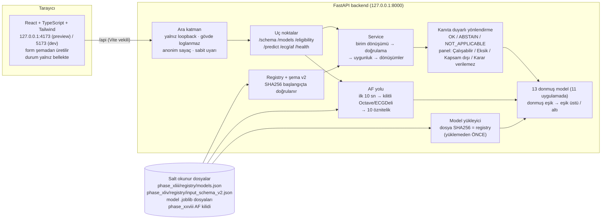
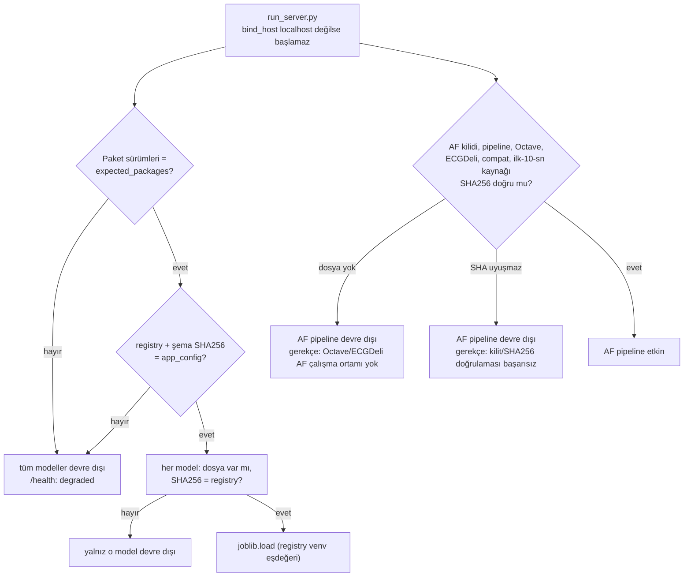
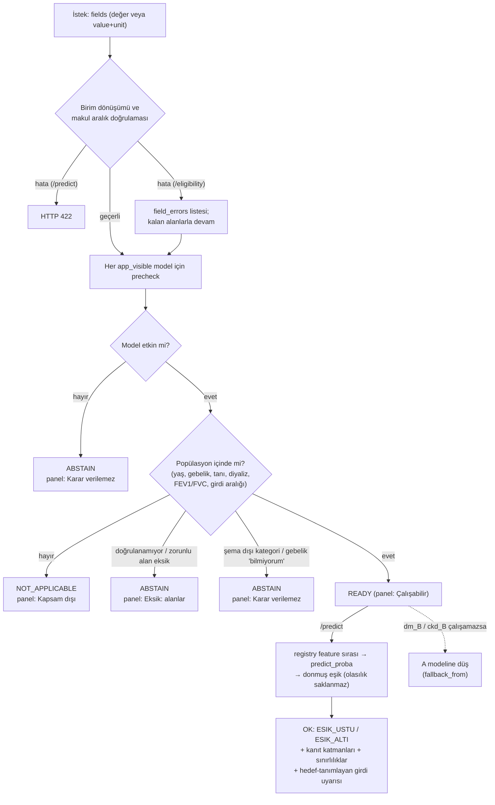
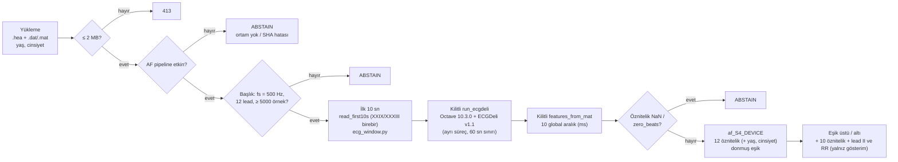

# Mimari

Araştırma prototipi. Model **mevcut durumu** sınıflandırır; gelecek risk tahmini değildir. Klinik karar aracı değildir.
Bu belge Phase XLVI'da yazıldı; diyagramların SVG/PNG çıktıları `img/` altındadır ve bu dosyadaki Mermaid
kaynaklarından `phase_xlvi/scripts/render_diagrams.mjs` ile üretilmiştir (elle çizilmedi).

İlgili belgeler: [API](api.md) · [OpenAPI](openapi.json) · [Kurulum](INSTALL.md) · [Deney tabloları](experiment_tables.md) ·
[Model kartları](model_cards/README.md)

## 1. Bileşenler

| bileşen | konum | görev |
|---|---|---|
| Arayüz | `app/frontend/src/` | form (`/schema`'dan), canlı panel (`/eligibility`), sonuçlar (`/predict`), EKG sayfası (`/ecg/af`), model kartları, hakkında. Olasılık göstermez; uyarı metni backend'den gelir. |
| Ara katman | `app/backend/healthrisk_api/main.py` | loopback dışı → 403; istek gövdesi/sağlık verisi loglanmaz; beklenmeyen hatada yalnız hata türü; her yanıtta `disclaimer`. |
| Service | `service.py`, `validation.py`, `eligibility.py`, `transforms.py`, `features.py` | birim dönüşümü ve aralık (422), popülasyon uygunluğu, 46 dönüşüm (şema v2), registry feature sırası, `precheck` (`/predict` ve `/eligibility` ortak). |
| Registry ve şema | `phase_xliii/registry/models.json`, `phase_xliv/registry/input_schema_v2.json` | model, eşik, feature sırası, kanıt, sınırlılık; alanlar, birimler, dönüşümler. SHA256'ları `app_config.json` ile doğrulanır. |
| Model yükleyici | `model_loader.py` | model dosyasının SHA256'sı **yüklemeden önce** registry ile karşılaştırılır; uyuşmazlıkta model devre dışı (`/health`). |
| AF yolu | `ecg_af.py`, `ecg_window.py` | kilitli `phase_xxviii/pipeline/af_pipeline_v1.py` kopyalanmadan çağrılır; kilit, Octave exe, ECGDeli kaynak ağacı ve compat dosyaları SHA ile doğrulanır. |

## 2. Başlangıç bütünlük denetimi

## 3. Kanıta duyarlı yönlendirme (/predict ve /eligibility)

- **Eksik veri doldurulmaz.** Zorunlu alan eksikse ABSTAIN; dondurulmuş imputer kullanılmaz. Yapısal boşluklar (ör. erkekte
  menopoz) eğitimdeki kuralla işlenir.
- **Irk isteğe bağlıdır.** Yanıtsızsa ırk kullanan 5 model (dm A/B, ckd A/B, htn) ABSTAIN eder; varsayılan sınıf atanmaz.
- **AF satırı** `/predict`'te her zaman NOT_APPLICABLE'dır (yalnız `/ecg/af`). `/eligibility`'de: ortam varken
  "Eksik: EKG kaydı", **ortam yoksa "Karar verilemez: Octave/ECGDeli AF çalışma ortamı yok"** (Phase XLVI).
  Kişiye özel neden de varsa (kapsam dışı yaş, eksik alan) ana satır o nedendir; ortam nedeni altında "Ayrıca: …"
  (`additional_reasons`; Phase XLVI kapanış düzeltmesi).
- **Arayüzde sade metin (Phase L).** Sunucu gerekçe ve alan hatası metinleri DEĞİŞMEZ; arayüz bunları
  `app_config.json > ui.reason_rules_tr` / `ui.field_error_rules_tr` kurallarıyla sade Türkçeye çevirir
  (`frontend/src/lib/plain.ts`; ör. `weight_kg=500 kg makul aralık dışında [25, 300]` → "Kilo 25–300 kg arasında olmalı.").
  Ham metin yalnız "Teknik ayrıntı" içinde kalır. Kurallar, sunucunun ürettiği tüm metinlerin sentetik taramasıyla
  (`phase_l/scripts/scan_reasons.py`) Vitest'te denetlenir.
- **Canlı panel eski yanıtı göstermez (Phase L).** `/eligibility` yanıtı istendiği girdinin anahtarıyla saklanır; girdi
  değişince yeni yanıt gelene dek durum rozeti gösterilmez (önceden "Formu temizle" sonrası kısa süre, istek hatasında
  süresiz eski "Hesaplanabilir" görünüyordu).
- **Kompakt durum paneli (Phase L2).** Her analiz tek satırda: ad, durum rozeti ve "x/y bilgi girildi" ilerlemesi.
  İlerleme, modelin formdan girilen zorunlu alanlarından hesaplanır.
  - Eksikler katlıdır ("Eksikleri göster").
  - Hiç bilgi girilmemişse nötr "Henüz bilgi girilmedi" görünür. Sunucu durumu yine `MISSING`'dir; değişen yalnız
    gösterimdir.
  - Birden çok analizde aynı olan sade gerekçe, panelin üstünde bir kez yazılır.

## 4. AF yolu (/ecg/af)

- Kilit: `phase_xxviii/config/af_pipeline_lock.json` (AF-ECGDELI-OCTAVE-v1). Pipeline dosyası değiştirilmez ve kopyalanmaz.
- Aynı anda tek kayıt işlenir (ikinci istek 429). Geçici dosyalar yanıttan önce silinir.
- Eğitim öznitelikleri PTB-XL+ yayımlanmış ECGDeli değerleridir; uygulama ve dış doğrulama kilitli Octave yeniden
  uygulamasını kullanır. Fark ve doğrulaması: `phase_xlvi/af_validation_dossier.md` §2.

## 5. Gizlilik ve güvenlik

- Sunucu yalnız `127.0.0.1`; loopback dışı istemci 403. Kimlik doğrulama yok (tek kullanıcı, yerel kullanım).
- İstek gövdesi ve sağlık verisi loglanmaz, diske yazılmaz. 422 ayrıntısı girdi değerini yansıtmaz.
- Tarayıcıda kalıcı saklama yok (localStorage, sessionStorage, IndexedDB kullanılmaz); analitik yok; istekler yalnız
  aynı köken `/api`.
- Testler: `app/backend/tests/test_privacy.py`, `app/frontend/e2e/privacy.spec.ts`.

## 6. Diyagram dosyaları

| diyagram | SVG | PNG |
|---|---|---|
| 1. Bileşenler | [img/01_components.svg](img/01_components.svg) | [img/01_components.png](img/01_components.png) |
| 2. Başlangıç bütünlük denetimi | [img/02_startup.svg](img/02_startup.svg) | [img/02_startup.png](img/02_startup.png) |
| 3. Kanıta duyarlı yönlendirme | [img/03_routing.svg](img/03_routing.svg) | [img/03_routing.png](img/03_routing.png) |
| 4. AF yolu | [img/04_af_path.svg](img/04_af_path.svg) | [img/04_af_path.png](img/04_af_path.png) |
